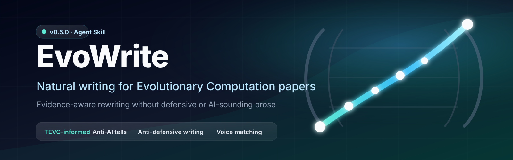

<div align="center">



# EvoWrite

**Plain, natural, evidence-aware writing for Evolutionary Computation papers.**

Distilled from **1,517 TEVC papers (1997–2023)** and a stratified review of 150 papers. EvoWrite rebuilds AI-sounding prose, removes software metaphors and stock LLM phrasing, and preserves claims, evidence, standard EC terminology, and the author's voice.

[简体中文](README.zh-CN.md) · [Quick start](docs/quickstart.md) · [Cases](docs/cases.html) · [Docs](docs/)

[](https://github.com/Wenhua-Li/evo-writing-skill/releases)
[](https://agentskills.io)
[](LICENSE)
[](skill/references/evidence/methodology.md)

</div>

---

## See the difference

<table>
<tr><th>Before — AI-sounding and defensive</th><th>After — plain EC prose</th></tr>
<tr><td>

> With the rapid development of evolutionary computation, large-scale multiobjective optimization has become a hot topic. It is worth noting that our proposed method may potentially significantly outperform state-of-the-art algorithms, although we do not claim that it is universally optimal for all problems. The main contributions are as follows: 1) We propose a novel framework. 2) We design an efficient operator. 3) We conduct extensive experiments.

</td><td>

> Large-scale multiobjective optimization becomes harder as the number of decision variables increases. This paper presents a search framework and a variation operator for this setting. On the tested problems, the proposed algorithm outperforms the algorithms included in the comparison.

</td></tr>
</table>

**No invented results. No defensive disclaimer. No generic AI phrasing.**

## Why EvoWrite?

Generic humanizers can make text smoother while retaining abstract, inflated, or engineering-flavored wording. EvoWrite combines full paragraph rewriting, EC-specific evidence checks, and a mandatory language gate:

- Rebuilds sentences from the research meaning when surface polishing is insufficient.
- Rejects software, management, and promotional metaphors in paper prose.
- Requires zero unapproved occurrences of the blocked vocabulary and stock contrast patterns.
- Distinguishes `function evaluations`, wall-clock runtime, model-training cost, and implementation complexity.
- Distinguishes convergence, diversity, feasibility, objective value, and fitness.
- Understands surrogate-assisted, constrained, dynamic, large-scale, multimodal, and multiobjective optimization.
- Keeps necessary methodological boundaries once, in the section where the reader needs them.
- Matches the rhythm of an author's writing sample without copying its blocked wording.

## Quick start

```bash
npx skills add Wenhua-Li/evo-writing-skill
```

Or:

```bash
curl -fsSL https://raw.githubusercontent.com/Wenhua-Li/evo-writing-skill/main/install.sh | bash
```

Windows PowerShell:

```powershell
iwr https://raw.githubusercontent.com/Wenhua-Li/evo-writing-skill/main/install.ps1 | iex
```

Then ask:

```text
Use evo-write. Rewrite this introduction to remove AI tells and defensive writing.
Return only the revised English.
```

More options: [`docs/install.html`](docs/install.html) and [`docs/quickstart.md`](docs/quickstart.md).

## What it does

### Rebuilds AI-sounding prose

For text with heavy AI phrasing, EvoWrite records the research meaning and writes the paragraph again. It does not merely exchange adjectives, connectors, or synonyms while keeping the original sentence skeleton.

### Enforces plain EC English

The hard gate covers the reported terms `axes`, `synthetic`, `provenance`, `admission`, `extreme`, `declared`, `protocol`, `tie`, `saturated`, `trajectories`, `certified`, `menus`, `audit`, `inferred`, `rather than`, `trial`, `rival`, and `refinement`, together with common variants and related LLM wording.

A hit requires another rewrite; it is not delivered as a warning. Narrow technical exceptions protect standard usage such as DE `trial vector`, an actual robot trajectory, a stated `synthetic data` category, coordinate axes, and established `extreme solutions`. The complete rules are in [`skill/data/prose-gate.json`](skill/data/prose-gate.json).

### Checks structure and repetition

The gate rejects stock `rather than`, `instead of`, and `not X but Y` contrasts, empty research-interest openings, defensive `do not claim` wording, unqualified robustness and scalability claims, repeated sentence-opening connectors, three consecutive sentences with the same two-word opening, and repeated non-technical six-word sequences. Human review remains necessary because a clean lexical scan alone does not prove naturalness.

### Removes defensive writing

- `We do not claim...` → a direct statement of the evaluation scope;
- `may potentially suggest` → `suggests`, `indicates`, or a precise bounded statement;
- repeated limitations → one concrete limitation in the right section.

### Preserves scientific meaning

EvoWrite does not invent or silently strengthen research. It preserves citations, DOIs, numerical results, uncertainty, negative results, theorem conditions, benchmark names, baselines, indicators, budgets, statistical tests, algorithm mechanisms, assumptions, and application constraints.

### Audits claim strength when asked

Audit mode flags unsupported or over-scoped claims such as `statistically significant` without a test, `optimal` without a guarantee, `robust` without a perturbation model, `scalable` without dimension and budget ranges, and `efficient` without a defined cost measure.

## How it works


When an execution environment is available, the exact candidate text can be checked with:

```bash
python tools/scripts/check_prose.py -
```

The checker uses Python's standard library only. The same JSON rules are applied manually when no execution environment is available.

## Evidence base

The public package contains aggregate evidence and original guidance, not the source papers.

- Corpus: 1,517 TEVC Markdown papers from 1997–2023
- Language analysis: 1,358 quality-controlled papers
- Qualitative review: 150 stratified papers across periods, paper types, and research settings
- Excluded: 2024+ papers and unassigned early-access material
- Purpose: domain grounding and confirmation of common EC expressions, not permission to use blocked wording

See [`skill/references/evidence/methodology.md`](skill/references/evidence/methodology.md), [`corpus-findings.md`](skill/references/evidence/corpus-findings.md), and [`limitations.md`](skill/references/evidence/limitations.md).

## Repository layout

```text
├── SKILL.md          # evo-write entry point
├── skill/            # runtime references, voices, examples, templates, data
├── docs/             # website, guides, cases, release notes, public assets
├── tools/            # corpus analysis, prose gate, and behavior evaluations
├── install.sh
├── install.ps1
└── install-manifest.txt
```

## Limits

- EvoWrite improves readability and claim calibration; it does not guarantee publication.
- It does not aim to fool AI detectors; it aims to read naturally to human reviewers.
- The corpus evidence is TEVC-specific and independent of IEEE or TEVC editorial policy.
- Source papers are not included. Aggregate statistics and original guidance are included instead.
- Voice matching depends on the quality of the supplied writing sample.

## Contributing

Contributions are welcome, especially EC-specific before/after examples, behavior cases for unsupported claims, domain guides, and installer improvements. See [`.github/CONTRIBUTING.md`](.github/CONTRIBUTING.md).

## Citation

```bibtex
@software{li_evowrite_2026,
  author  = {Li, Wenhua},
  title   = {EvoWrite: Natural Evolutionary Computation Paper Writing},
  year    = {2026},
  version = {0.5.0},
  url     = {https://github.com/Wenhua-Li/evo-writing-skill},
  license = {MIT and CC-BY-4.0}
}
```

## Acknowledgements

EvoWrite's structural analysis of AI tells was inspired by [blader/humanizer](https://github.com/blader/humanizer), and its claim-forward and positive-scope treatment was inspired by [Kiterlin/anti-defensive-writing](https://github.com/Kiterlin/anti-defensive-writing). The rules, examples, and domain evidence here are redesigned for Evolutionary Computation.

## License

- Scripts: [MIT License](LICENSE)
- Skill documentation, rules, templates, examples, and aggregate data: [CC BY 4.0](LICENSE-CC-BY-4.0)

## Star History

[](https://star-history.com/#Wenhua-Li/evo-writing-skill&Date)
