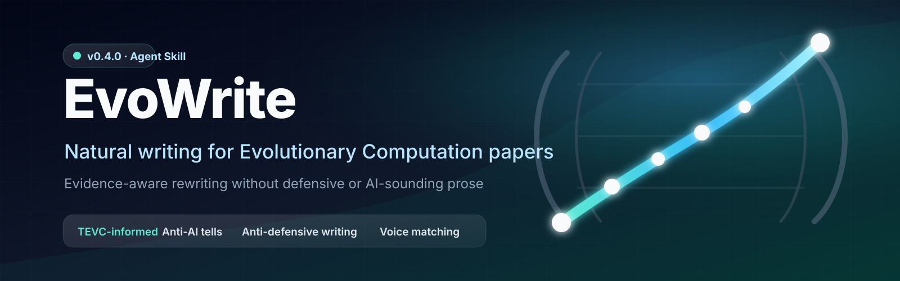

<div align="center">



# EvoWrite

**Natural, evidence-aware writing for Evolutionary Computation papers.**

Distilled from **1,517 TEVC papers (1997–2023)** and a stratified review of 150 papers. EvoWrite removes AI tells and defensive prose while preserving claims, evidence, EC terminology, and the author's voice.

[简体中文](README.zh-CN.md) · [Quick start](docs/quickstart.md) · [Cases](docs/cases.html) · [Docs](docs/)

[](https://github.com/Wenhua-Li/evo-writing-skill/releases)
[](https://agentskills.io)
[](LICENSE)
[](skill/references/evidence/methodology.md)

</div>

---

## See the difference

<table>
<tr><th>Before — AI-sounding and defensive</th><th>After — natural EC prose</th></tr>
<tr><td>

> With the rapid development of evolutionary computation, large-scale multiobjective optimization has become a hot topic. It is worth noting that our proposed method may potentially significantly outperform state-of-the-art algorithms, although we do not claim that it is universally optimal for all problems. The main contributions are as follows: 1) We propose a novel framework. 2) We design an efficient operator. 3) We conduct extensive experiments.

</td><td>

> Large-scale multiobjective optimization remains challenging for evolutionary algorithms as the number of decision variables increases. This paper addresses this setting and makes three contributions: a framework for large-scale multiobjective optimization, an efficient search operator, and an extensive experimental evaluation. On the tested problems, the proposed algorithm outperforms the state-of-the-art algorithms included in the comparison.

</td></tr>
</table>

**No invented results. No defensive disclaimer. No generic AI phrasing.**

## Why EvoWrite?

Generic humanizers can make text smoother, but they do not know what makes an EC claim technically wrong. EvoWrite checks both **human readability** and **field-specific evidence use**:

- Distinguishes `function evaluations`, wall-clock runtime, model-training cost, and implementation complexity.
- Distinguishes convergence, diversity, feasibility, objective value, and fitness.
- Understands surrogate-assisted, constrained, dynamic, large-scale, multimodal, and multiobjective optimization.
- Removes AI tells, forced templates, boilerplate openings, stacked hedges, and defensive disclaimers.
- Keeps necessary methodological boundaries once, in the section where the reader needs them.
- Can match the rhythm and habits of your own English writing sample.

## Quick start

```bash
npx skills add Wenhua-Li/evo-writing-skill
```

Or:

```bash
curl -fsSL https://raw.githubusercontent.com/Wenhua-Li/evo-writing-skill/main/install.sh | bash
```

Windows PowerShell:

```powershell
iwr https://raw.githubusercontent.com/Wenhua-Li/evo-writing-skill/main/install.ps1 | iex
```

Then ask:

```text
Use evo-write. Rewrite this introduction to remove AI tells and defensive writing.
Return only the revised English.
```

More options: [`docs/install.html`](docs/install.html) and [`docs/quickstart.md`](docs/quickstart.md).

## What it does

### Humanizes EC prose

Removes grand openings, forced contribution lists, mechanical RQs, empty importance claims, repeated transitions, and template-like results prose.

### Removes defensive writing

- `We do not claim...` → `The evaluation focuses on...`
- `may potentially suggest` → `suggests`, `indicates`, or a precise bounded statement
- repeated limitations → one concrete limitation in the right section

### Preserves scientific meaning

EvoWrite does not invent or silently strengthen research. It preserves citations, DOIs, numerical results, uncertainty, negative results, theorem conditions, benchmark names, baselines, indicators, budgets, statistical tests, algorithm mechanisms, assumptions, and application constraints.

### Audits claim strength when asked

Audit mode flags unsupported or over-scoped claims such as `statistically significant` without a test, `optimal` without a guarantee, `robust` without a perturbation model, `scalable` without dimension and budget ranges, and `efficient` without a defined cost measure.

## How it works


EvoWrite reads only the references needed for the task: rewriting rules for humanization, article/section/domain guidance for drafting, the supplied sample for voice matching, and claim-calibration rules for audit mode.

## Evidence base

The public package contains aggregate evidence and original guidance, not the source papers.

- Corpus: 1,517 TEVC Markdown papers from 1997–2023
- Language analysis: 1,358 quality-controlled papers
- Qualitative review: 150 stratified papers across periods, paper types, and research settings
- Excluded: 2024+ papers and unassigned early-access material
- Purpose: domain grounding, not template extraction

See [`skill/references/evidence/methodology.md`](skill/references/evidence/methodology.md), [`corpus-findings.md`](skill/references/evidence/corpus-findings.md), and [`limitations.md`](skill/references/evidence/limitations.md).

## Repository layout

```text
├── SKILL.md          # evo-write entry point
├── skill/            # runtime references, voices, examples, templates, data
├── docs/             # website, guides, cases, release notes, public assets
├── tools/            # corpus analysis scripts and behavior evaluations
├── install.sh
├── install.ps1
└── install-manifest.txt
```

## Limits

- EvoWrite improves readability and claim calibration; it does not guarantee publication.
- It does not aim to fool AI detectors; it aims to read naturally to human reviewers.
- The corpus evidence is TEVC-specific and independent of IEEE or TEVC editorial policy.
- Source papers are not included. Aggregate statistics and original guidance are included instead.
- Voice matching depends on the quality of the supplied writing sample.

## Contributing

Contributions are welcome, especially EC-specific before/after examples, behavior cases for unsupported claims, domain guides, and installer improvements. See [`.github/CONTRIBUTING.md`](.github/CONTRIBUTING.md).

## Citation

```bibtex
@software{li_evowrite_2026,
  author  = {Li, Wenhua},
  title   = {EvoWrite: Natural Evolutionary Computation Paper Writing},
  year    = {2026},
  version = {0.4.0},
  url     = {https://github.com/Wenhua-Li/evo-writing-skill},
  license = {MIT and CC-BY-4.0}
}
```

## Acknowledgements

EvoWrite's structural AI-tell pipeline was inspired by [blader/humanizer](https://github.com/blader/humanizer), and its claim-forward and positive-scope treatment was inspired by [Kiterlin/anti-defensive-writing](https://github.com/Kiterlin/anti-defensive-writing). The rules, examples, and domain evidence here are redesigned for Evolutionary Computation.

## License

- Scripts: [MIT License](LICENSE)
- Skill documentation, rules, templates, examples, and aggregate data: [CC BY 4.0](LICENSE-CC-BY-4.0)

## Star History

[](https://star-history.com/#Wenhua-Li/evo-writing-skill&Date)
